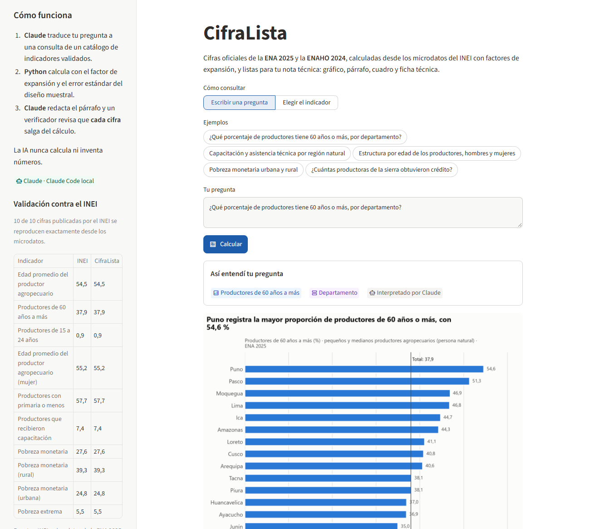
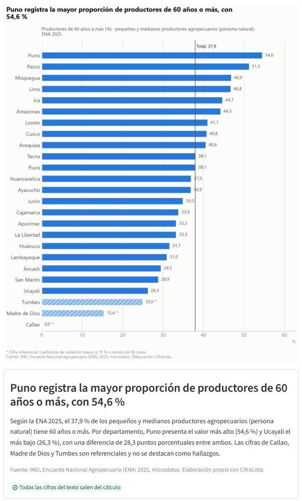
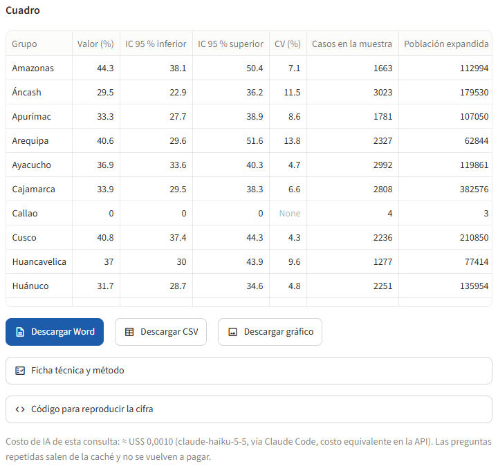
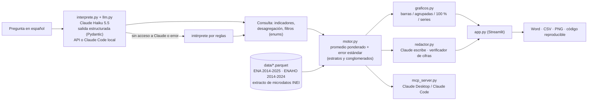

# CifraLista

**Hacemos gráficos, notas y cuadros con cifras oficiales de la ENA y la ENAHO para analistas públicos, consultores
y tesistas del Perú, mediante una IA que entiende la pregunta y un motor que calcula desde los microdatos del INEI, sin
inventar ninguna cifra.**

> Demo: **[cifralista.streamlit.app](https://cifralista.streamlit.app)** · Video de respaldo (76 s, narrado con voz
> sintética): [docs/video/cifralista_demo.mp4](https://github.com/loryac21-cyber/cifralista/raw/main/docs/video/cifralista_demo.mp4)
> · Proyecto final de la Diplomatura Q-Lab PUCP ([issue #204](https://github.com/d2cml-ai/Data-Science-Python/issues/204))

| | |
|---|---|
| Pregunta → resultado | ~10 segundos: gráfico, párrafo verificado, cuadro con IC 95 % y CV, Word y código reproducible |
| Años | **ENA 2014-2025** (en 2020 no hubo ENA) y **ENAHO 2014-2024**: cada año se calcula con su propia muestra, y las series avisan el cambio de diseño de la ENA en 2023 |
| Validación | **21 de 21** cifras publicadas por el INEI se reproducen exactas desde los microdatos (ENA 2022 y 2025; pobreza monetaria de cada año 2014-2024) |
| Pruebas | **91** pruebas automáticas (`uv run --group mcp pytest`) |
| Costo de IA por consulta | ≈ **US$ 0,002** con Claude Haiku 5.5, medido ([detalle](#7-modelo-de-negocio)) |

---

## 1. One-liner

**CifraLista convierte una pregunta en lenguaje natural («¿qué porcentaje de productores tiene 60 años o más, por
departamento?») en el gráfico, el párrafo y el cuadro que van en una nota técnica, con cifras oficiales calculadas
desde los microdatos del INEI y verificadas una por una.**

## 2. Founder

**Lory Acosta Carbajal**, economista en la Dirección de Estudios Económicos del Ministerio de Desarrollo Agrario y
Riego (MIDAGRI). Escribo notas técnicas con la ENA y la ENAHO: la última, *«Sin relevo en el campo: por qué envejece el
productor agropecuario peruano»*. Para escribirla tuve que citar notas de prensa del INEI en vez de procesar los
microdatos, y dejar un «dato pendiente» porque la cifra que necesitaba no estaba publicada. Ese es el problema que
resuelve CifraLista.

Además conozco el lado técnico: en la tarea 4 del curso construí un agente con el MCP del BCRP y *skills* de la ENAHO
que reproducen las cifras oficiales de pobreza (25/25 departamentos), y medí que un modelo sin herramientas **inventa
cifras con citas creíbles** cuando no se le permite decir «no sé». Contacto: [LinkedIn](https://www.linkedin.com/in/lory-acosta).

## 3. Problema

**Quién lo sufre.** Analistas del Estado y de gremios que escriben notas técnicas; consultores que arman diagnósticos
socioeconómicos y líneas de base; tesistas de economía, sociología y ciencias agrarias; periodistas de datos.

**Cómo lo resuelven hoy y cuánto les cuesta.**

- **Procesan los microdatos en Stata, R o Python.** La ENA 2025 viene en más de 15 capítulos que hay que unir por
  seis llaves; la ENAHO exige filtrar residentes habituales y expandir la pobreza con `factor07 × mieperho`. Un error
  común cambia el resultado: la pobreza 2024 sin ponderar da **25,6 %** en vez de **27,6 %**. Hacer bien una sola
  cifra con su desagregación toma horas, y la primera vez, días (estimación propia, que se contrasta en las
  conversaciones de [`docs/research/`](docs/research/)).
- **Citan publicaciones y notas de prensa.** Solo tienen los cortes que el INEI decidió publicar, a veces con cortes de
  edad que cambian entre años.
- **Le preguntan a un chatbot.** Sin datos, el modelo inventa. En mi evaluación de la tarea 4, un modelo sin
  herramientas obligado a responder dio 3 cifras falsas de 10 preguntas, con citas al INEI que parecían reales.
- **Pagan cursos o consultorías.** La Escuela del INEI y las universidades venden cursos de Stata con la ENAHO.

**La señal de demanda.** En el repositorio nacional ALICIA (CONCYTEC) hay **644** trabajos que mencionan la ENAHO y solo
**19** la Encuesta Nacional Agropecuaria (consulta del 10/11/2026): la ENA se usa poco porque es difícil, no porque no
importe. Herramientas genéricas como Julius AI cobran US$ 35–45 al mes y no conocen el diseño muestral del INEI.

**Conversaciones con usuarios:** notas de 3 conversaciones en [`docs/research/`](docs/research/), con la guía y la
evidencia secundaria.

## 4. Solución e insight

**El insight: la IA no debe calcular, debe elegir.** CifraLista separa las tres cosas que un chatbot mezcla:

1. **Entender** (IA): Claude traduce la pregunta a una consulta de un **catálogo cerrado de 19 indicadores validados**
   con salida estructurada: los indicadores, la desagregación y los filtros son *enums* del esquema, así que no puede
   pedir nada que no exista.
2. **Calcular** (Python, sin IA): promedios ponderados con el factor de expansión, **error estándar por linealización
   de Taylor** con los estratos y conglomerados del diseño, IC 95 % y coeficiente de variación. Lo que el INEI
   considera referencial (CV > 15 %) se marca en el gráfico, el texto y el cuadro.
3. **Redactar** (IA + verificador): Claude escribe el título analítico y el párrafo solo con los números ya
   calculados, y un verificador revisa que **cada número del texto** salga del cálculo. Si aparece uno que no, se
   marca y se ofrece el texto por plantilla.

El resultado sale en el formato de una nota técnica: gráfico con fuente, párrafo, cuadro con IC y CV, ficha técnica,
**Word** listo para pegar y el **código pandas** que reproduce la cifra para el anexo metodológico de una tesis.

El mismo motor está disponible como **servidor MCP** (`mcp_server.py`), para quien escribe sus notas dentro de Claude.

## 5. Why now

- **Salidas estructuradas confiables y baratas.** Hoy un modelo pequeño (Claude Haiku 5.5, US$ 0,10 por millón de
  tokens de entrada) devuelve JSON que cumple un esquema con *enums*. Hace tres años los modelos no garantizaban el
  formato, costaban decenas de veces más por consulta y no había un estándar como MCP para conectarlos a herramientas.
- **La evidencia de que la IA sola no basta.** En septiembre de 2026, Pew Research Center publicó que los encuestados
  sintéticos se equivocan unos 12 puntos en promedio. Los datos reales del INEI siguen siendo la fuente; lo que faltaba
  era un acceso que no exija Stata.
- **Datos públicos recientes y con historia.** La ENA 2014-2025 y la ENAHO 2014-2024 están en el portal de microdatos
  del INEI, y un extracto de 8 MB alcanza para responder el catálogo, año por año o en serie, en un servidor gratuito.

## 6. Demo

**URL pública:** <https://cifralista.streamlit.app> (Streamlit Community Cloud).

La app tiene **tres modos**, y las cifras son las mismas en los tres porque las calcula Python:

| Modo | Cuándo se activa | Qué hace la IA |
|---|---|---|
| **API de Anthropic** | Hay `ANTHROPIC_API_KEY` en `.env` o en los *Secrets* de Streamlit | Claude interpreta y redacta (modo de producción) |
| **Claude Code local** | No hay clave, pero la computadora tiene Claude Code con sesión iniciada | Lo mismo, con `claude -p --json-schema` (salida estructurada) y sin clave de API |
| **Reglas** | Ninguno de los anteriores (por ejemplo, la URL pública mientras no se active la API) | Nada: palabras clave y plantillas. Responde las preguntas de ejemplo y las del modo «Elegir el indicador» |

**Correrlo en local** (se necesita [uv](https://docs.astral.sh/uv/)):

```bash
git clone https://github.com/loryac21-cyber/cifralista.git
cd cifralista
uv sync
uv run streamlit run app.py
```

Opcional: `copy .env.example .env` y poner ahí una `ANTHROPIC_API_KEY`. Sin clave, la app usa Claude Code si está
instalado y, si no, el intérprete por reglas.

**Enlace para compartir una consulta:** `?q=` abre la pregunta ya resuelta, por ejemplo
<https://cifralista.streamlit.app/?q=Pobreza%20monetaria%20urbana%20y%20rural>.

Pruebas: `uv run --group mcp pytest`. Servidor MCP: `claude mcp add --scope project cifralista -- uv run --group mcp mcp_server.py`.

**Capturas**

| Pregunta, interpretación y validación contra el INEI | Gráfico y párrafo verificado | Cuadro con IC y CV, y descargas |
|---|---|---|
|  |  |  |

**Arquitectura**



**Modelos y APIs, y por qué.**

| Pieza | Qué usa | Por qué |
|---|---|---|
| Interpretar la pregunta | Claude Haiku 5.5 (`claude-haiku-5-5`) con `messages.parse` y un modelo Pydantic | Tarea corta de clasificación: el modelo más barato con salidas estructuradas; los *enums* impiden inventar indicadores. Prompt del sistema con caché |
| Redactar el párrafo | Claude Haiku 5.5, esfuerzo `low` | Texto breve a partir de cifras ya calculadas; el verificador cubre el riesgo |
| Sin clave de API | Claude Code (`claude -p --json-schema`, mismo modelo y esquema) | Permite desarrollar y hacer el demo local sin pagar la API; no se usa en un servidor público |
| Respaldo | Intérprete por reglas y texto por plantilla | El demo nunca se cae si no hay internet, clave o saldo |
| Datos | Extracto propio de los microdatos del INEI (`scripts/preparar_datos.py`) | Sin API externa: más rápido y reproducible. El script se detiene si una cifra no coincide con el INEI |

El modelo se cambia con `CIFRALISTA_MODELO` en `.env`.

**Series y comparabilidad.** Una serie es un cálculo por año, cada uno con su muestra y su factor de expansión, nunca
un promedio de años. Lo que cambia entre años se avisa en la app, en el gráfico y en el párrafo:

- **ENA:** en 2020 no hubo encuesta; la de 2021 no tuvo el capítulo de servicios financieros (crédito, seguro, ahorro)
  ni la lengua materna; en 2021-2023 solo se encuestó a pequeños y medianos productores (las empresas pesan menos de
  0,1 puntos en el total). **Desde 2023 la ENA usa un nuevo diseño muestral** (segmentos y `FACTOR_PRODUCTOR`): el
  gráfico corta la línea en 2022-2023 y el texto describe cada tramo por separado, sin compararlos.
- **ENAHO:** 2020 es atípico (parte de las entrevistas fueron telefónicas por la pandemia). La pobreza monetaria de
  cada año, 2014-2024, coincide con la serie oficial del INEI.
- **Error estándar:** linealización de Taylor con conglomerados (`CONGLOMERADO` hasta 2022, segmentos `NSEGM` desde
  2023) y estratos departamento × región natural (más los estratos del marco de lista hasta 2019). Es una aproximación
  conservadora: con el diseño de la ENA 2023-2025, cuyos factores varían mucho, varios indicadores poco frecuentes salen
  «referenciales» por departamento.

## 7. Modelo de negocio

**Quién paga y cuánto** (precios en soles, con IGV):

| Plan | Para quién | Precio | Incluye |
|---|---|---|---|
| Gratis | Estudiantes que prueban | S/ 0 | 10 consultas al mes, sin Word |
| Tesis | Tesistas de pregrado y maestría | **S/ 19 al mes** o S/ 59 por 6 meses | Consultas ilimitadas, Word, código reproducible |
| Profesional | Analistas y consultores independientes | **S/ 49 al mes** | Todo lo anterior + MCP + indicadores nuevos cada mes |
| Equipo | Consultoras, ONG, universidades privadas | **S/ 390 al mes** (5 usuarios) | Indicadores a medida (otros módulos, Censo por distrito) |
| Nota express (servicio) | Quien necesita el entregable hecho | **S/ 350 a 800 por nota** | Nota técnica con cuadros, gráficos y ficha, hecha con CifraLista |

La **nota express** es el ingreso del primer mes: el producto baja mi tiempo por nota y el servicio financia el
desarrollo mientras crecen las suscripciones.

**Cuánto cuesta cada usuario.**

- **Tokens (medido el 10/11/2026 en 4 preguntas reales):** interpretar usa ~4 600 tokens de entrada (el catálogo va
  en el prompt del sistema, que se cachea) y 400–670 de salida, entre US$ 0,0005 y 0,0018; redactar cuesta
  US$ 0,0008–0,0012. Total: **≈ US$ 0,002 por consulta** con Claude Haiku 5.5 (US$ 0,10 y 0,50 por millón de
  tokens). Un usuario intensivo (300 consultas al mes) cuesta **≈ US$ 0,60 al mes**. La app muestra el costo al pie
  de cada consulta.
- **Servidor:** US$ 0 en Streamlit Community Cloud durante el piloto; con usuarios pagantes, un servidor de
  US$ 10–25 al mes alcanza para cientos de usuarios (≈ US$ 0,10–0,25 por usuario).
- **Cobro:** pasarela local (Culqi o Mercado Pago), alrededor de 4 % por transacción.
- **Margen bruto:** cerca de 90 % en el plan Profesional, aun con un usuario intensivo: S/ 49 ≈ US$ 13 frente a
  ≈ US$ 1,4 de costo (tokens, servidor y cobro).
- **Tope de gasto:** límite mensual en la consola de Anthropic y tope de consultas con IA por sesión en la URL pública
  (`CIFRALISTA_MAX_CONSULTAS_IA`); además, la misma pregunta se responde desde caché y no se paga dos veces.

**Meta de ingreso adicional (6 meses):** 20 profesionales (S/ 980) + 30 tesistas (S/ 570) + 1 nota express al mes
(S/ 500) ≈ **S/ 2 050 al mes**.

**Primeros usuarios.** (1) Compañeras y compañeros de la diplomatura y de mi red de analistas; (2) talleres gratuitos
de 1 hora en centros de estudiantes de economía, con el plan Tesis como oferta; (3) LinkedIn: publicar cada semana una
cifra de la ENA hecha con CifraLista; (4) consultoras que hacen líneas de base, con una nota express de prueba.

**Qué sigue.** Más módulos (empleo e ingresos de la ENAHO, ENA por cultivo), series por departamento, mapas, Censo 2017 por distrito para diagnósticos de proyectos, y cuentas de usuario con cobro.

**Riesgos y cómo los manejo.**

- **Conflicto de interés:** trabajo en el Estado. CifraLista solo usa datos públicos; no le vendo a mi entidad ni a
  entidades vinculadas a mis funciones, y mis clientes son privados (tesistas, consultoras, ONG). Antes de cobrar,
  consulto a la oficina de integridad de mi entidad las reglas de incompatibilidad y de doble percepción.
- **Errores de cálculo:** cada indicador nuevo entra con una prueba contra una cifra publicada por el INEI.
- **El INEI mejora su portal:** el valor está en la redacción, la precisión y el formato de nota técnica, no solo en
  el acceso.

## 8. Herramientas del curso

| Herramienta del curso | Dónde está | Para qué |
|---|---|---|
| **LLMs con salidas estructuradas (sesión 08)** | [`cifralista/interprete.py`](cifralista/interprete.py) (modelo `Consulta` con *enums*), [`cifralista/redactor.py`](cifralista/redactor.py) (modelo `Texto` + verificador), [`cifralista/llm.py`](cifralista/llm.py) (API o Claude Code) | Traducir la pregunta a una consulta válida y redactar sin inventar cifras |
| **Dashboards con Streamlit (sesión 05)** | [`app.py`](app.py), [`cifralista/graficos.py`](cifralista/graficos.py) | La app pública: pregunta, gráfico, cuadro, descargas y validación contra el INEI |
| Extra: **MCP (sesión 04)** | [`mcp_server.py`](mcp_server.py), [`.mcp.json`](.mcp.json) | El mismo motor como herramientas para Claude |
| Extra: **Despliegue (sesión 12)** | [cifralista.streamlit.app](https://cifralista.streamlit.app), [`requirements.txt`](requirements.txt), [`.streamlit/config.toml`](.streamlit/config.toml) | URL pública gratuita en Streamlit Community Cloud, con tope de consultas con IA y caché |
| Extra: **Skills de la ENAHO (sesión 16)** | [`scripts/preparar_datos.py`](scripts/preparar_datos.py) | Las reglas de limpieza de mi *skill* `limpiando-enaho` (residentes habituales, `factor07 × mieperho`, validación contra el INEI), ampliadas a la ENA |

**Por qué estas:** las salidas estructuradas son lo que hace segura la IA en este producto (no puede elegir algo
fuera del catálogo), y Streamlit da una URL pública gratis con descargas. El MCP lleva el motor a donde ya trabaja un
analista que usa Claude.

## 9. Qué hizo el agente

Usé **Claude Code** (Claude Opus 5.5) como programador. **Generó:** el script de preparación de datos, el motor con
error estándar por linealización, el catálogo, el intérprete, el redactor y el verificador, los gráficos, la exportación
a Word, la app Streamlit, el servidor MCP, las 91 pruebas, el borrador de este README, la guía de entrevistas y el
guion del pitch. También hizo la búsqueda de competencia y el conteo en ALICIA. Después del pitch amplió los datos a
2014-2025: ubicó en el catálogo del INEI los módulos de cada año, armonizó las variables (que casi no cambian entre
años), detectó el cambio de diseño de la ENA en 2023 y corrigió el error estándar del diseño nuevo.

**Hice yo:** la idea a partir de mi propia nota técnica; la elección de indicadores, universos y cortes de edad del
INEI; la revisión de cada cifra contra las publicaciones del INEI; las conversaciones con usuarios; el modelo de negocio
y la presentación. Entiendo el código y puedo explicar o cambiar cualquier parte; las decisiones metodológicas están en
los comentarios de [`motor.py`](cifralista/motor.py) y [`catalogo.py`](cifralista/catalogo.py).

---

### Estructura

```
cifralista/
├── app.py                    # app Streamlit
├── mcp_server.py · .mcp.json # servidor MCP
├── cifralista/               # catalogo, motor, interprete, redactor, graficos, exportar, validacion
├── scripts/preparar_datos.py # de los microdatos del INEI a data/*.parquet, con validación
├── data/                     # extracto de la ENA 2014-2025 y la ENAHO 2014-2024 (8 MB)
├── tests/                    # 91 pruebas: cifras del INEI por año, series, intérprete, verificador, MCP
├── docs/research/            # conversaciones con usuarios y evidencia
├── docs/pitch.md             # guion de 3 minutos y del video
└── LICENSE · .env.example · .gitignore · pyproject.toml · uv.lock · requirements.txt
```

**Datos:** extracto de los microdatos públicos del INEI (ENA 2014-2025: capítulos 700, 800, 900 y 1100; ENAHO
2014-2024: sumaria y módulo 02; los códigos de cada año están en el script), sin coordenadas ni identificadores de
vivienda. Para regenerarlo: `uv run --group datos scripts/preparar_datos.py --descargar` (baja unos 500 MB del INEI).
Licencia del código: MIT.
